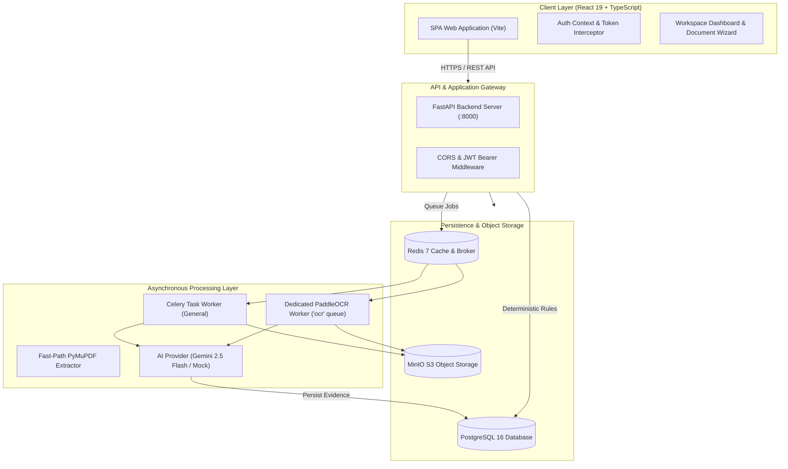
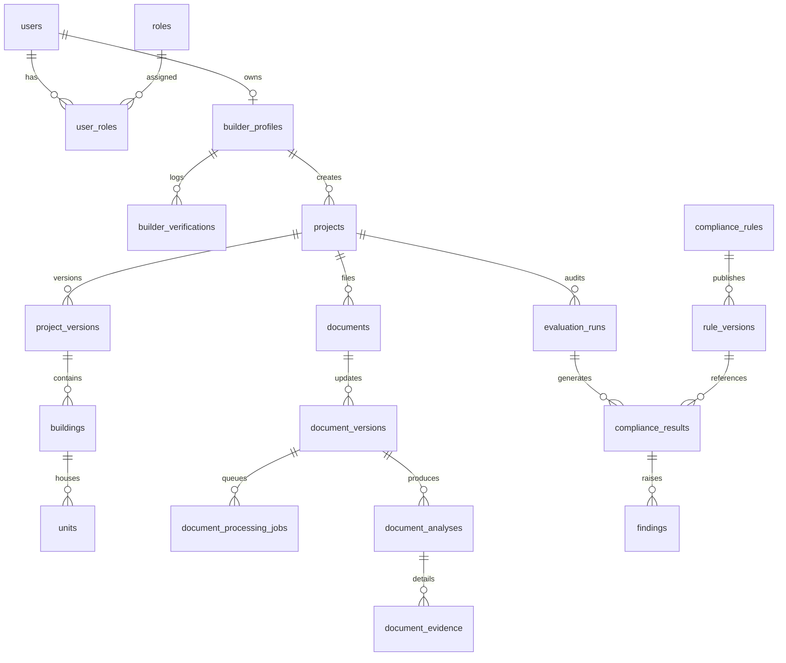

# PropertyGuard AI

> **AI-Assisted Property Compliance & Risk Assessment Platform**  
> An enterprise-grade platform combining AI/OCR document understanding with a deterministic regulatory rules engine to verify real estate project approvals, municipal bylaws, RERA compliance, fire safety norms, and property hierarchies.

---

## 1. Executive Summary & Core Philosophy

**PropertyGuard** is designed for real estate developers (Builders), institutional investors, prospective buyers, and regulatory authorities. It solves the critical bottleneck in real estate due diligence: analyzing complex architectural plans, land titles, municipal sanction orders, and fire safety NOCs against intricate legal bylaws.

### The Central Architecture Principle: The Trust Boundary
A foundational design decision in PropertyGuard is the **strict separation between AI extraction and Regulatory Compliance decision-making**:

```
+-----------------------------------------------------------------------------------+
|                              UNTRUSTED / PROBABILISTIC                             |
|  Uploaded Documents -> Optical Character Recognition (OCR) -> AI Entity Extraction|
+-----------------------------------------------------------------------------------+
                                         |
                                         v
                         Structured Facts & Evidence Items
                   (Field Values, Page Numbers, Confidence Scores)
                                         |
                                         v
+-----------------------------------------------------------------------------------+
|                              TRUSTED / DETERMINISTIC                              |
|   PostgreSQL Evidence Store -> Deterministic Rules Engine -> PASS / FAIL / REVIEW  |
|            (Audit Trail, Versioned Bylaws, Dependency Resolution)                 |
+-----------------------------------------------------------------------------------+
```

- **Large Language Models and OCR tools are probabilistic**: They excel at reading noisy scanned blueprints, extracting dates, license numbers, and architectural dimensions, but they can hallucinate or fluctuate.
- **Regulatory law is deterministic**: A building setback either complies with municipal fire codes or it does not. A RERA certificate is either valid and unexpired or it is not.
- **Therefore**: AI never renders compliance verdicts in PropertyGuard. AI extracts *facts and evidence*; the backend's deterministic rule engine executes *legal and bylaw assertions* against those facts.

---

## 2. System Architecture & Topology

The PropertyGuard platform is organized into three major tiers: a modern React frontend workspace, an asynchronous FastAPI + Celery backend with microservice-style workers, and a backing infrastructure of PostgreSQL, Redis, and MinIO.

### Architecture Diagram



---

## 3. End-to-End Workflow

### Step 1: User Onboarding & Role Verification
1. A user registers via `POST /api/v1/auth/register` choosing either `BUILDER` or `BUYER`.
2. When registering as a `BUILDER`, a company `BuilderProfile` is created with `verification_status = PENDING`.
3. An `ADMIN` reviews corporate documentation and verifies the builder (`POST /api/v1/admin/builders/{id}/verification`).
4. Only builders with `verification_status == VERIFIED` are authorized to create real estate projects.

### Step 2: Project Shell Creation & Hierarchy Setup
1. The builder creates a project with property type (e.g. `APARTMENT`, `VILLA`, `COMMERCIAL`) via `POST /api/v1/projects`.
2. The system auto-generates `ProjectVersion` 1 in `DRAFT` status.
3. Builders can add buildings/towers (`POST /api/v1/projects/{id}/buildings`) and individual units/flats (`POST /api/v1/projects/buildings/{building_id}/units`).

### Step 3: Document Requirement Catalog & Upload
1. The frontend queries `GET /api/v1/projects/required-documents?project_type=APARTMENT`.
2. The catalog identifies mandatory requirements:
   - **Sanctioned Building Plan** (`SANCTIONED_PLAN`) — Mandatory
   - **Land Title Deed** (`LAND_TITLE`) — Mandatory
   - **Encumbrance Certificate** (`ENCUMBRANCE_CERTIFICATE`) — Mandatory
   - **RERA Registration Certificate** (`RERA`) — Mandatory
   - **Fire Safety NOC** (`FIRE_NOC`) — Mandatory
3. The frontend validates the document format and size against `POST /api/v1/documents/validate`.
4. The document is uploaded via `POST /api/v1/documents` and stored as raw bytes in MinIO, generating a SHA-256 content checksum.

### Step 4: Asynchronous Processing Pipeline
1. Processing is initiated via `POST /api/v1/documents/versions/{version_id}/process`.
2. A `DocumentProcessingJob` is created in `QUEUED` state and dispatched to Celery via Redis.
3. **Smart Extraction Routing**:
   - Digital text PDFs execute the high-speed **PyMuPDF (fitz)** extractor path directly in milliseconds.
   - Scanned blueprint drawings and image PDFs route to the **Dedicated PaddleOCR Worker** on the isolated `ocr` queue. Pages are rasterized into 300 DPI pixmaps and parsed for textual contents.
4. **AI Semantic Entity Extraction**:
   - Extracted document text is provided to the configured `DocumentAIProvider` (Google Gemini or offline Mock).
   - Structured JSON is generated extracting:
     - Project name, developer name, survey/plot numbers, municipal ward
     - Approval dates, expiration dates, issuing authority
     - Building height, setback distances (front, rear, side), FSI/FAR ratios
     - Exact verbatim citations and page number pointers
5. Extracted evidence is persisted into `document_analyses` and `document_evidence` tables, and job status becomes `COMPLETED`.

### Step 5: Deterministic Compliance Evaluation
1. The user triggers an audit evaluation run via `POST /api/v1/projects/{id}/evaluations`.
2. The `ComplianceService` constructs an immutable `EvidenceContext` comprising project parameters and verified document evidence.
3. The service fetches all active `ComplianceRule` records matching the project's jurisdiction and property type.
4. The `RuleEvaluator` computes outcomes:
   - Checks presence of required certificates (`DOCUMENT_EXISTS`)
   - Validates that approvals have not lapsed (`DOCUMENT_NOT_EXPIRED`)
   - Validates numerical bylaws like setback tolerances and height limits (`NUMERIC_COMPARISON`, `FIELD_RANGE`)
   - Evaluates boolean prerequisite graphs (`LOGICAL_AND`, `RuleDependency`)
5. Produces an `EvaluationRun` record, individual `ComplianceResult` items (`PASS`, `FAIL`, `NEEDS_REVIEW`), and creates persistent `Finding` and `Discrepancy` tickets for any non-compliant items.

---

## 4. Key Domains & Technical Specifications

### A. Authentication & Role-Based Access Control (RBAC)
- **Files**: `app/models/user.py`, `app/models/role.py`, `app/core/security.py`, `app/core/jwt.py`, `app/services/auth_service.py`
- **Supported Roles**:
  - `SUPER_ADMIN`: Full unrestricted access to system configuration, rules, and accounts.
  - `ADMIN`: Verifies builder profiles, approves/rejects project submissions, oversees regulatory governance.
  - `BUILDER`: Manages real estate projects, uploads architectural files, triggers evaluations, reviews findings.
  - `BUYER`: Public search access to verified project data and compliance certifications.
- **Security**: Passwords hashed with `pwdlib` (Argon2 / modern Bcrypt); access secured with signed JWT bearer tokens expiring every 30 minutes.

### B. Project & Hierarchy Management
- **Files**: `app/models/project.py`, `app/services/project_service.py`, `app/api/v1/project.py`
- **Data Model**:
  - `Project`: Root development record (name, property type, location, soft deletion timestamp `deleted_at`, builder ownership).
  - `ProjectVersion`: Tracks iterations (e.g. initial proposal vs. amended plans) with lifecycle states `DRAFT`, `PENDING_REVIEW`, `APPROVED`, `REJECTED`.
  - `Building`: Physical structures (towers, wings) associated with a project version.
  - `Unit`: Specific apartments, flats, or commercial bays within a building.
- **Soft Deletion**: Projects are protected by soft deletion (`status = INACTIVE`, `deleted_at = <timestamp>`) ensuring historical compliance audits and past evaluations are never lost.

### C. Document Management & Object Storage
- **Files**: `app/models/document.py`, `app/integrations/storage.py`, `app/services/document_service.py`
- **Storage Layer**: MinIO S3-compatible object store. Documents are segregated into isolated buckets.
- **Versioning**: Each re-upload creates an incremental `DocumentVersion` linked to the parent `Document` record.
- **Integrity**: Every uploaded document calculates a SHA-256 cryptographic hash to ensure byte-level non-repudiation.

### D. Multi-Modal OCR & Worker Pipelines
- **Files**: `app/ocr_service/paddle_ocr_service.py`, `app/ocr_worker/celery_app.py`, `app/ocr_worker/tasks.py`, `app/workers/document_tasks.py`
- **Architecture**:
  - **Main Celery Worker**: Listens to the default queue for general background jobs.
  - **OCR Worker**: Dedicated process listening on the isolated `ocr` Redis queue. Prevents CPU-heavy computer vision tasks from starving fast API background tasks.
  - **PaddleOCR**: Renders PDF pages to memory buffers and runs deep-learning optical character recognition with confidence scoring per text box.

### E. AI Document Understanding & Extraction Engine
- **Files**: `app/integrations/ai/base.py`, `app/integrations/ai/factory.py`, `app/integrations/ai/gemini_provider.py`, `app/integrations/ai/mock_provider.py`
- **Pluggable Architecture**:
  - `DocumentAIProvider`: Standardized protocol defining `analyze(extracted_document) -> AIAnalysisResult`.
  - `GeminiDocumentAIProvider`: Leverages Google GenAI SDK with Gemini models and strict JSON Pydantic schemas. Extracts key semantic fields, overall confidence, document classification, and exact quote citations.
  - `MockDocumentAIProvider`: Deterministic regex-based extractor used during automated testing and CI pipelines without requiring internet access or API credits.

### F. Deterministic Rules Engine
- **Files**: `app/rules/evaluator.py`, `app/rules/context.py`, `app/rules/types.py`, `app/rules/exceptions.py`
- **Operators Implemented**:
  | Operator | Description |
  | :--- | :--- |
  | `DOCUMENT_EXISTS` | Verifies presence and valid status of required document types |
  | `DOCUMENT_NOT_EXPIRED` | Verifies document expiration timestamp has not passed |
  | `FIELD_EXISTS` | Asserts existence of an extracted metadata property |
  | `FIELD_EQUALS` | Asserts exact match on extracted field value |
  | `FIELD_NOT_EQUALS` | Asserts inequality on extracted field value |
  | `FIELD_MIN` / `FIELD_MAX` | Asserts numeric boundary conditions (e.g. min setback, max floor area) |
  | `FIELD_RANGE` | Asserts value falls within inclusive min-max range |
  | `LOGICAL_AND` | Conjunction operator requiring all child sub-rules to evaluate to PASS |
  | `LOGICAL_OR` | Disjunction operator requiring at least one child rule to PASS |
  | `LOGICAL_NOT` | Negation operator inverting evaluation outcome |

---

## 5. Database Schema & Migration History

### Entity Relationship Model



### Alembic Migration Ledger
The database schema is strictly version-controlled through 10 linear Alembic migrations:
1. `8cd5cd6de10d`: Creates `users`, `roles`, `user_roles`, `builder_profiles`, and `builder_verifications`.
2. `f4389b6f5a25`: Creates `projects`, `project_versions`, `buildings`, and `units`.
3. `bef3375deee5`: Creates `documents` and `document_versions`.
4. `b77bd630b8da`: Creates `compliance_rules` and `rule_versions`.
5. `a723c7e5cafd`: Creates `rule_applicability`, `rule_dependencies`, `compliance_results`, `findings`, and `discrepancies`.
6. `e25ec3f37715`: Adds rule evaluation metadata and operator structures to `rule_versions`.
7. `5d6d672ab7f7`: Adds `evaluation_runs` table for compliance audit tracking.
8. `55a170864b95`: Adds `document_processing_jobs` table for Celery worker tracking.
9. `72cc7b4c2798`: Adds `document_analyses` and `document_evidence` tables for AI/OCR results.
10. `9b7d2a6c4e11`: Adds `projects.deleted_at` timestamp column and index for non-destructive soft deletion.

---

## 6. API Reference Catalog

All endpoints are versioned under `/api/v1`.

### Authentication (`/api/v1/auth`)
| Method | Endpoint | Access | Description |
| :--- | :--- | :--- | :--- |
| `POST` | `/api/v1/auth/register` | Public | Register a new user account (Buyer or Builder) |
| `POST` | `/api/v1/auth/login` | Public | Authenticate with credentials and receive a JWT token |
| `GET` | `/api/v1/auth/me` | Authenticated | Fetch profile and assigned roles for current token |

### Builder Workspace (`/api/v1/builder`)
| Method | Endpoint | Access | Description |
| :--- | :--- | :--- | :--- |
| `GET` | `/api/v1/builder/profile` | Builder | Get builder company profile and verification state |
| `POST` | `/api/v1/builder/profile` | Builder | Create initial company profile |

### Real Estate Projects (`/api/v1/projects`)
| Method | Endpoint | Access | Description |
| :--- | :--- | :--- | :--- |
| `GET` | `/api/v1/projects` | Authenticated | List accessible projects (Builders see owned; Admins see all) |
| `POST` | `/api/v1/projects` | Verified Builder | Create new project with auto-generated Version 1 draft |
| `GET` | `/api/v1/projects/{project_id}` | Authenticated | Retrieve project details, buildings, versions, and metrics |
| `PATCH` | `/api/v1/projects/{project_id}` | Builder / Admin | Modify project name, description, address, or property type |
| `DELETE` | `/api/v1/projects/{project_id}` | Builder / Admin | Soft-delete a project (preserves history, sets status=INACTIVE) |
| `GET` | `/api/v1/projects/required-documents` | Authenticated | Get required document catalog tailored to property type |
| `POST` | `/api/v1/projects/{project_id}/buildings` | Builder / Admin | Add a building/tower structure to the project |
| `POST` | `/api/v1/projects/buildings/{id}/units` | Builder / Admin | Add an individual unit/flat to a building |

### Documents & Processing (`/api/v1/documents`)
| Method | Endpoint | Access | Description |
| :--- | :--- | :--- | :--- |
| `POST` | `/api/v1/documents/validate` | Authenticated | Pre-flight validation of document type, mime-type, and size |
| `POST` | `/api/v1/documents` | Builder / Admin | Upload document binary to MinIO and register version record |
| `GET` | `/api/v1/documents/{document_id}` | Authenticated | Get document details and all historical versions |
| `GET` | `/api/v1/documents/versions/{version_id}/download` | Authenticated | Stream raw document binary from MinIO |
| `POST` | `/api/v1/documents/versions/{version_id}/process` | Builder / Admin | Dispatch asynchronous OCR/PyMuPDF and AI extraction job |
| `GET` | `/api/v1/documents/processing-jobs/{job_id}` | Authenticated | Poll job execution state, progress, and errors |
| `GET` | `/api/v1/documents/{document_id}/analysis` | Builder / Admin | Retrieve latest completed AI analysis & semantic evidence |

### Compliance Evaluations & Findings
| Method | Endpoint | Access | Description |
| :--- | :--- | :--- | :--- |
| `POST` | `/api/v1/projects/{project_id}/evaluations` | Builder / Admin | Execute deterministic rules engine run against project |
| `GET` | `/api/v1/projects/{project_id}/evaluations` | Authenticated | List historical evaluation audit runs |
| `GET` | `/api/v1/projects/{project_id}/evaluations/{run_id}` | Authenticated | Retrieve results breakdown for a specific audit run |
| `GET` | `/api/v1/projects/{project_id}/findings` | Authenticated | Query open regulatory non-compliance findings |
| `PATCH` | `/api/v1/projects/findings/{finding_id}` | Builder / Admin | Update finding status (`OPEN`, `RESOLVED`, `WAIVED`) |

### Administration (`/api/v1/admin`)
| Method | Endpoint | Access | Description |
| :--- | :--- | :--- | :--- |
| `POST` | `/api/v1/admin/builders/{id}/verification` | Admin | Approve or reject a builder's corporate profile |
| `POST` | `/api/v1/admin/project-versions/{id}/review` | Admin | Formally approve or reject a project version revision |

---

## 7. Frontend Application Architecture

The user interface is an accessible, responsive web application located in `/frontend`.

- **Framework**: React 19 with TypeScript, bundled using Vite.
- **Styling Architecture**: Vanilla CSS Modules with custom design tokens (`index.css`), avoiding third-party CSS overhead while delivering refined typography (Inter), responsive cards, micro-animations, and status tags.
- **Component Design**:
  - `Navbar`: Session identity, role badges, navigation gates.
  - `Card`, `Button`, `Input`, `Badge`: Composable UI building blocks.
  - `LandingPage`: Explains product value, interactive architecture breakdown, and trust boundaries.
  - `DashboardPage`: Complete builder and admin workspace with project creation wizard, required-document upload checklist, real-time Celery polling, AI evidence inspector drawer, compliance rule audit history, and soft-delete/modify dialogs.
- **State & Routing**:
  - `AuthContext`: Centralized authentication provider managing JWT tokens in `localStorage` and syncing user session on refresh.
  - `AppRoutes`: Client-side route declarations with `ProtectedRoute` guards.

---

## 8. Development & Setup Guide

### Prerequisites
- Python 3.11+ (or Python 3.14)
- Node.js 18+ and npm
- Docker and Docker Compose

### 1. Launch Supporting Infrastructure
From the project root:
```powershell
docker compose up -d
```
This starts:
- **PostgreSQL 16**: Port `5432` (db: `propertyguard`, user: `propertyguard`, password: `propertyguard_dev_password`)
- **Redis 7**: Port `6379` (Celery broker and result backend)
- **MinIO**: Port `9000` (API) and Port `9001` (Web Console, user: `propertyguard_admin`, password: `propertyguard_minio_password`)

### 2. Backend Setup
From the `/backend` directory:
```powershell
cd backend
python -m venv .venv
.\.venv\Scripts\activate
pip install -r requirements.txt
```

Run database migrations:
```powershell
alembic upgrade head
```

Seed initial RBAC roles and compliance rules:
```powershell
python -m app.seeds.roles
python scripts/seed_compliance_rules.py
python scripts/fix_compliance_rule_versions.py
```

### 3. Run Backend Server & Background Workers
Start the FastAPI server:
```powershell
uvicorn app.main:app --host 127.0.0.1 --port 8000 --reload
```

In a separate terminal, start the primary Celery worker:
```powershell
celery -A app.workers.celery_app.celery_app worker --loglevel=info -Q celery
```

In another terminal, start the dedicated OCR Celery worker:
```powershell
celery -A app.ocr_worker.celery_app.ocr_celery_app worker --loglevel=info -Q ocr
```

### 4. Frontend Setup
From the `/frontend` directory:
```powershell
cd frontend
npm install
npm run dev
```
Open `http://localhost:5173` in your browser.

---

## 9. Testing & Quality Assurance

PropertyGuard includes a comprehensive test suite of over 126 automated tests verifying services, API endpoints, rules logic, and background task flows.

Run all tests:
```powershell
cd backend
python -m pytest -v
```

### Test Suite Map:
- `tests/rules/test_evaluator.py`: Tests all 10+ deterministic rule operators and boolean trees.
- `tests/api/test_evaluation_runs_api.py`: Tests compliance evaluation triggering, findings endpoints, and RBAC security.
- `tests/api/test_project_documents_flow.py`: Tests document requirement retrieval, upload validation, and ownership.
- `tests/integrations/test_ai_factory.py`: Tests AI provider factory instantiation and error states.
- `tests/integrations/test_gemini_document_ai_provider.py`: Tests Gemini schema generation and response parsing.
- `tests/integrations/test_mock_document_ai_provider.py`: Tests regex extraction logic of mock AI provider.
- `tests/services/test_auth_service.py`: Tests user creation, password verification, and builder verification gating.
- `tests/services/test_compliance_service.py`: Tests multi-rule evaluation runs, dependencies, and discrepancy reporting.
- `tests/services/test_project_service.py`: Tests project hierarchy, builder ownership checks, and soft deletion.
- `tests/workers/test_document_tasks.py`: Tests asynchronous Celery pipeline execution, rollback handling, and status tracking.

---

## 10. Summary of Key Files

| Directory / File | Description |
| :--- | :--- |
| `docker-compose.yml` | Container definitions for PostgreSQL, Redis, and MinIO |
| `backend/app/main.py` | FastAPI application factory, CORS settings, route registrations |
| `backend/app/core/` | Database sessions, JWT crypto, security hashes, environment config |
| `backend/app/models/` | SQLAlchemy ORM models for auth, builders, projects, documents, compliance |
| `backend/app/rules/` | Deterministic rules engine (evaluator, context, types, exceptions) |
| `backend/app/integrations/` | MinIO storage adapter and Google Gemini / Mock AI providers |
| `backend/app/ocr_service/` | PaddleOCR service with PyMuPDF rendering |
| `backend/app/ocr_worker/` | Dedicated Celery worker application and OCR processing tasks |
| `backend/app/workers/` | Main Celery worker and document processing pipeline tasks |
| `backend/app/services/` | Business domain services (auth, project, builder, document, compliance) |
| `backend/app/api/v1/` | FastAPI REST API routers for auth, builder, projects, documents, admin |
| `backend/alembic/` | Database schema migration versions (10 versioned migrations) |
| `frontend/src/App.tsx` | Root React application container and router setup |
| `frontend/src/context/` | Session management and authentication context |
| `frontend/src/pages/` | Public landing page, login, register, and full interactive dashboard |
| `frontend/src/components/` | Reusable design system components (buttons, badges, inputs, cards, navbar) |
